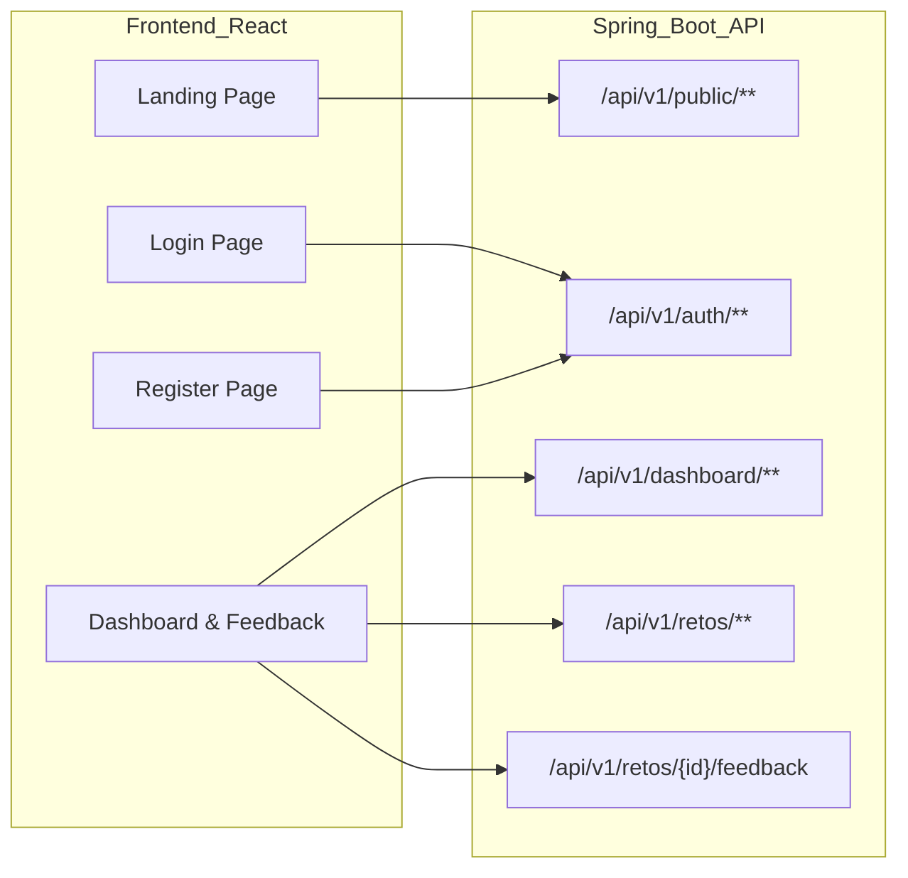

Listed directory src
Listed directory pages
Listed directory auth
Listed directory dashboard
Listed directory landing
Listed directory services
Listed directory components
Viewed App.jsx:1-79
Viewed LandingPage.jsx:1-294
Viewed LoginPage.jsx:1-145
Viewed RegisterPage.jsx:1-3
Viewed Register.jsx:1-49
Listed directory registro
Viewed RegisterForm.jsx:1-96
Viewed DashboardPage.jsx:1-3
Viewed DashboardMainPage.jsx:1-66
Listed directory dashboard
Viewed ChallengeTable.jsx:1-231
Viewed FeedbackDrawer.jsx:1-120
Viewed Header.jsx:1-78
Viewed SubNavigation.jsx:1-54
Viewed NextSessionCard.jsx:1-24
Viewed SupportBanner.jsx:1-32
Listed directory context
Listed directory hooks
Listed directory layouts
Viewed DashboardLayout.jsx:1-25
Viewed package.json:1-31

Como **Arquitecto de Software Senior en Spring Boot**, he auditado exhaustivamente el frontend en React (`LandingPage.jsx`, `LoginPage.jsx`, `RegisterPage.jsx` / `RegisterForm.jsx`, y la suite del `Dashboard`: `DashboardMainPage`, `ChallengeTable`, `FeedbackDrawer`, `Header`, `KpiCard`, etc.).

A continuación presento la **Especificación Técnica Oficial de la API REST**, el mapeo bidireccional DTO $\leftrightarrow$ Entidades JPA de tu modelo de dominio estricto (`Empresa`, `Usuario`, `RolUsuario`, `Reto`, `EstadoReto`, `Prioridad`, `CategoriaAcademica`, `HistorialReto`, `GrupoAsignado`), la matriz de discrepancias y el diseño de la arquitectura por capas en **Spring Boot 3.x / Java 21**.

---

# 1. Catálogo Exacto de Endpoints REST

La API se estructura bajo el estándar `/api/v1`, separando rutas públicas, de autenticación y de gestión operativa protegidas con Spring Security (JWT).



### Tabla Resumen de Endpoints

| Módulo | Método | Ruta URI | Descripción Funcional | Nivel de Acceso |
| :--- | :---: | :--- | :--- | :--- |
| **Landing** | `GET` | `/api/v1/public/landing/kpis` | Métricas públicas del Hero Banner (+120 retos, 48 empresas, etc.) | Público |
| **Landing** | `GET` | `/api/v1/public/retos/destacados` | Lista de retos en convocatoria visible a visitantes | Público |
| **Auth** | `POST` | `/api/v1/auth/login` | Autenticación con email, password y flag rememberMe | Público |
| **Auth** | `POST` | `/api/v1/auth/register` | Registro inicial de usuarios según formulario de React | Público |
| **Auth** | `POST` | `/api/v1/auth/refresh-token` | Renovación de token JWT si `rememberMe` fue activado | Público / Cookie |
| **Dashboard** | `GET` | `/api/v1/dashboard/empresa/kpis` | Retorna los 4 KPIs del panel superior de la empresa autenticada | `ROLE_EMPRESA` |
| **Dashboard** | `GET` | `/api/v1/dashboard/empresa/perfil-resumen` | Datos del Header (Nombre de empresa, verificación, badge) | `ROLE_EMPRESA` |
| **Dashboard** | `GET` | `/api/v1/dashboard/proxima-sesion` | Información del widget `NextSessionCard` (Demo Day, fecha) | `ROLE_EMPRESA`, `ROLE_DOCENTE`, `ROLE_ESTUDIANTE` |
| **Dashboard** | `GET` | `/api/v1/retos` | Tabla de retos con filtros (`estado`, `search`) y paginación | Autenticado |
| **Dashboard** | `POST` | `/api/v1/retos` | Acción del botón *"Publicar Nuevo Reto"* (Header y SubNav) | `ROLE_EMPRESA` |
| **Dashboard** | `GET` | `/api/v1/retos/{id}/feedback` | Hilo de retroalimentación del `FeedbackDrawer` para un reto | Autenticado con acceso al reto |
| **Dashboard** | `POST` | `/api/v1/retos/{id}/feedback` | Envío de comentario/instrucción técnica en el `FeedbackDrawer` | Autenticado con acceso al reto |
| **Dashboard** | `GET` | `/api/v1/retos/{id}/historial` | Trazabilidad y auditoría de cambios de estado del reto | Autenticado |

---

# 2. Estructura Exacta en JSON (Request DTO & Response DTO)

Diseñados exactamente para satisfacer las variables de estado (`useState`), props y estructuras que consumen los componentes de React.

---

### 2.1. Landing Page

#### `GET /api/v1/public/landing/kpis`
Alimenta el banner flotante en `LandingPage.jsx`:
```json
// Response DTO (LandingStatsResponse)
{
  "retosResueltos": 120,
  "empresasAliadas": 48,
  "tasaExito": 98,
  "estudiantesVinculados": 500
}
```

#### `GET /api/v1/public/retos/destacados`
Alimenta la sección `featuredChallenges` en `LandingPage.jsx`:
```json
// Response DTO (List<FeaturedChallengeResponse>)
[
  {
    "id": 1,
    "title": "Optimización de eCommerce con Inteligencia Artificial",
    "area": "Data Science & ML",
    "status": "En Convocatoria",
    "statusColor": "primary",
    "description": "Modelos predictivos para la demanda y personalización de inventario crítico en retail digital.",
    "deadline": "28 Mar 2026"
  },
  {
    "id": 2,
    "title": "Rediseño de App Móvil FinTech & Billetera Digital",
    "area": "UX/UI & Flutter",
    "status": "En Desarrollo",
    "statusColor": "tertiary",
    "description": "Arquitectura de experiencia de usuario enfocada en microfinanzas e inclusión financiera.",
    "deadline": "14 Abr 2026"
  }
]
```

---

### 2.2. Login (`LoginPage.jsx`)

El formulario gestiona `formData`: `{ email: '', password: '', rememberMe: false }`.

#### `POST /api/v1/auth/login`
```json
// Request DTO (LoginRequest)
{
  "email": "carlos.arango@novalogistics.com",
  "password": "Password123#",
  "rememberMe": true
}
```

```json
// Response DTO (AuthResponse)
{
  "accessToken": "eyJhbGciOiJIUzI1NiIsInR5cCI6IkpXVCJ9...",
  "refreshToken": "7c4a1b02-39c4-4f51-b8d2-9e32a6881234",
  "tokenType": "Bearer",
  "expiresIn": 86400,
  "user": {
    "id": 101,
    "fullName": "Carlos Arango",
    "email": "carlos.arango@novalogistics.com",
    "role": "ROLE_EMPRESA",
    "empresaId": 12,
    "empresaNombre": "NovaLogistics S.A.S."
  }
}
```

---

### 2.3. Registro (`RegisterForm.jsx`)

El formulario gestiona `values`: `{ fullName: '', email: '', password: '', userRole: '' }`.

#### `POST /api/v1/auth/register`
```json
// Request DTO (RegisterRequest)
{
  "fullName": "NovaLogistics S.A.S.",
  "email": "contacto@novalogistics.com",
  "password": "SuperSecretPassword123!",
  "userRole": "empresa" 
}
```
*(Valores permitidos en frontend para `userRole`: `"empresa"`, `"estudiante"`, `"docente"`)*.

```json
// Response DTO (UserRegistrationResponse)
{
  "id": 102,
  "fullName": "NovaLogistics S.A.S.",
  "email": "contacto@novalogistics.com",
  "role": "ROLE_EMPRESA",
  "createdAt": "2026-10-22T17:00:00Z",
  "message": "Usuario registrado exitosamente en el ecosistema CESDE Conecta."
}
```

---

### 2.4. Dashboard: KPIs y Perfil de Header

#### `GET /api/v1/dashboard/empresa/kpis`
Alimenta directamente el mapeo de `kpiData` en `DashboardMainPage.jsx`:
```json
// Response DTO (List<DashboardKpiResponse>)
[
  {
    "id": 1,
    "title": "Total Retos Activos",
    "icon": "flag",
    "value": "4",
    "trendIcon": "trending_up",
    "trendText": "+1 este mes",
    "subtitle": "Convocatorias simultáneas",
    "colorClass": "text-primary",
    "bgClass": "bg-primary-container/10",
    "hoverClass": "hover:border-primary-container/30"
  },
  {
    "id": 2,
    "title": "Equipos Postulados",
    "icon": "group_work",
    "value": "12",
    "trendIcon": "bolt",
    "trendText": "48 estudiantes",
    "subtitle": "Talento evaluando desafíos",
    "colorClass": "text-tertiary",
    "bgClass": "bg-tertiary-container/20",
    "hoverClass": "hover:border-tertiary/30"
  },
  {
    "id": 3,
    "title": "Proyectos en Desarrollo",
    "icon": "pending_actions",
    "value": "2",
    "trendIcon": "",
    "trendText": "Sprint 3 en curso",
    "subtitle": "Con acompañamiento docente",
    "colorClass": "text-secondary",
    "bgClass": "bg-secondary-container/30",
    "hoverClass": "hover:border-secondary/30"
  },
  {
    "id": 4,
    "title": "Tasa de Éxito",
    "icon": "verified_user",
    "value": "98%",
    "trendIcon": "check_circle",
    "trendText": "14 completados",
    "subtitle": "Cumplimiento metodológico",
    "colorClass": "text-primary-fixed",
    "bgClass": "bg-surface-container-high",
    "hoverClass": "hover:border-primary-container/30"
  }
]
```

#### `GET /api/v1/dashboard/empresa/perfil-resumen`
Alimenta `Header.jsx`:
```json
// Response DTO (CompanyHeaderProfileResponse)
{
  "empresaId": 12,
  "nombre": "NovaLogistics S.A.S.",
  "verificada": true,
  "plan": "Plan Enterprise • Alianza CESDE",
  "notificacionesPendientes": 1
}
```

#### `GET /api/v1/dashboard/proxima-sesion`
Alimenta `NextSessionCard.jsx`:
```json
// Response DTO (NextSessionResponse)
{
  "titulo": "Próxima Sesión de Sincronización",
  "detalle": "Jueves, 10:00 AM • Demo Day Previo de Equipos",
  "fechaHora": "2026-10-29T10:00:00Z"
}
```

---

### 2.5. Dashboard: Tabla de Retos (`ChallengeTable.jsx`)

El frontend cuenta con píldoras de filtro rápido (`Todos`, `En Convocatoria`, `En Desarrollo`, `Finalizados`, `Borradores`) y una caja de búsqueda.

#### `GET /api/v1/retos?page=0&size=10&estado=TODOS&search=`
```json
// Response DTO (PaginatedChallengeResponse)
{
  "totalItems": 5,
  "totalPages": 1,
  "currentPage": 0,
  "counters": {
    "todos": 5,
    "enConvocatoria": 2,
    "enDesarrollo": 2,
    "finalizados": 1,
    "borradores": 0
  },
  "content": [
    {
      "id": 1,
      "title": "Optimización de eCommerce con IA",
      "area": "Data Science & ML",
      "level": "Nivel Avanzado",
      "scheduleTitle": "Cierre: 28 Mar",
      "scheduleSubtitle": "Publicado hace 6 días",
      "status": "EN_CONVOCATORIA",
      "statusLabel": "En Convocatoria",
      "statusVariant": "primary",
      "assignedGroups": [
        { "id": 10, "code": "DS", "name": "DataSquad CESDE" },
        { "id": 11, "code": "AI", "name": "Artificial Intelligence Lab" }
      ],
      "extraGroupsCount": 3,
      "feedbackCount": 3,
      "isHighlighted": true
    },
    {
      "id": 2,
      "title": "Rediseño de App Móvil FinTech",
      "area": "UX/UI & Flutter",
      "level": "Sprint 2 de 4",
      "scheduleTitle": "Entrega: 14 Abr",
      "scheduleSubtitle": "Sprint activo",
      "status": "EN_DESARROLLO",
      "statusLabel": "En Desarrollo",
      "statusVariant": "tertiary",
      "assignedGroups": [
        { "id": 12, "code": "UX", "name": "UX Ninjas" },
        { "id": 13, "code": "FL", "name": "Flutter Force" }
      ],
      "extraGroupsCount": 0,
      "feedbackCount": 1,
      "isHighlighted": false
    }
  ]
}
```

---

### 2.6. Dashboard: Panel de Retroalimentación (`FeedbackDrawer.jsx`)

#### `GET /api/v1/retos/{id}/feedback`
```json
// Response DTO (ChallengeFeedbackThreadResponse)
{
  "retoId": 1,
  "retoTitulo": "Optimización de eCommerce con IA",
  "subtitulo": "Hilo sincronizado con Tutores y Postulantes",
  "messages": [
    {
      "id": 501,
      "authorName": "Mg. Carlos Arango",
      "authorRole": "Docente Asesor CESDE",
      "authorInitials": "Prof",
      "authorType": "DOCENTE",
      "timeLabel": "Ayer, 4:20 PM",
      "createdAt": "2026-10-21T16:20:00Z",
      "content": "Hola equipo NovaLogistics. Revisamos los requerimientos técnicos del reto de eCommerce con IA...",
      "attachment": null
    },
    {
      "id": 502,
      "authorName": "NovaLogistics (Tú)",
      "authorRole": "Líder de Innovación",
      "authorInitials": "NL",
      "authorType": "EMPRESA",
      "timeLabel": "Hoy, 9:15 AM",
      "createdAt": "2026-10-22T09:15:00Z",
      "content": "Excelente punto Carlos. Ya preparamos un CSV anonimizado con 45,000 registros...",
      "attachment": {
        "fileName": "dataset_muestra_ecommerce_v1.csv",
        "fileSize": "2.4 MB",
        "downloadUrl": "https://storage.cesde.edu.co/challenges/1/attachments/dataset_v1.csv"
      }
    }
  ]
}
```

#### `POST /api/v1/retos/{id}/feedback`
```json
// Request DTO (NewFeedbackMessageRequest)
{
  "content": "¿La métrica objetivo principal será RMSE o prefieren optimizar F1-Score en rotación de inventario crítico?",
  "attachmentUrl": null,
  "attachmentName": null,
  "attachmentSize": null
}
```

---

# 3. Matriz de Discrepancias y Campos Faltantes (Frontend vs Dominio)

Analizando el código JSX contra tu modelo de dominio relacional:
**Entidades**: `Empresa`, `Usuario` (`RolUsuario`), `Reto` (`EstadoReto`), `Prioridad` (SLA), `CategoriaAcademica`, `HistorialReto`, `GrupoAsignado`.

| # | Elemento Frontend | Brecha / Discrepancia Identificada | Impacto Arquitectónico y Solución Backend |
| :-: | :--- | :--- | :--- |
| **1** | **Formulario de Registro (`RegisterForm.jsx`)** | Pide únicamente `fullName`, `email`, `password`, `userRole`. **No solicita datos de la `Empresa`** (NIT, razón social, sector, etc.) aunque el rol sea `"empresa"`. | **Grave:** Un `Usuario` con rol `EMPRESA` no puede quedar huérfano de la entidad `Empresa`. **Solución:** En el Backend, si `userRole == "empresa"`, el servicio crea tanto el `Usuario` como un registro inicial de `Empresa` asignando `fullName` como la razón social preliminar, o se debe implementar un flujo de *Onboarding / Completar Perfil Empresarial*. |
| **2** | **Entidad `Prioridad` (SLA)** | La entidad de dominio `Prioridad` (SLA de atención/resolución) **no existe en ninguna vista del frontend**. Ni la tabla ni los cards la renderizan. | **Omisión de Dominio:** En la tabla se muestra "Nivel Avanzado", que en realidad es un atributo estético. **Solución:** El backend debe asignar una `Prioridad` predeterminada (`MEDIA` / `ESTANDAR`) al crear el reto y exponer un campo `prioridadSla` en los DTOs para que el frontend pueda pintar tags de prioridad si lo desea. |
| **3** | **`FeedbackDrawer` vs `HistorialReto`** | El frontend tiene un sistema de mensajería interactiva con adjuntos (`FeedbackDrawer.jsx`). En el modelo de dominio solo se tiene `HistorialReto`. | **Conflicto Semántico:** Tradicionalmente `HistorialReto` audita cambios de estado (`fechaCambio`, `estadoAnterior`, `estadoNuevo`, `usuarioResponsable`). **Solución:** Si no se permite crear una entidad `ComentarioReto`, `HistorialReto` debe soportar un tipo de evento polimórfico o campo discriminador: `tipoEvento = 'CAMBIO_ESTADO'` vs `tipoEvento = 'FEEDBACK_MENSAJE'`, guardando en `observaciones` el mensaje del chat y opcionalmente un campo `archivoAdjunto`. |
| **4** | **`CategoriaAcademica` en Retos** | En `LandingPage` y `ChallengeTable` se hardcodean strings como `"Data Science & ML"`, `"UX/UI & Flutter"`, `"IoT & Cloud AWS"`. | **Normalización:** No deben viajar como strings sueltos. La entidad `CategoriaAcademica` (id, nombre, descripcion) debe relacionarse `@ManyToOne` con `Reto`. El DTO mapea `categoriaAcademica.getNombre() -> area`. |
| **5** | **`GrupoAsignado` vs Avatares de Equipos** | La tabla muestra avatares circulares (`DS`, `AI`, `+3`, `4 Eq`, `DevX`). | `Reto` tiene `@OneToMany` con `GrupoAsignado`. El DTO de salida debe calcular el arreglo de iniciales (`code`), el conteo de grupos adicionales (`extraGroupsCount`) y el total de estudiantes vinculados agregando la lista. |
| **6** | **Atributos de Presentación UI en DTOs** | El frontend espera clases de Tailwind (`colorClass`, `statusColor`, `primary`, `tertiary`). | **Principio de Limpieza:** La base de datos no debe almacenar colores de CSS. El servicio Spring Boot o el Mapper (`MapStruct`) deben traducir el Enum `EstadoReto` hacia la variante de color correspondiente que espera React. |
| **7** | **Estado `rememberMe` en Login** | El switch de `rememberMe` no tiene contraparte estándar en JWT puro stateless. | **Solución:** Si `rememberMe == true`, emitir un *Refresh Token* con vigencia de 30 días en base de datos/cookie segura; de lo contrario, solo emitir *Access Token* de corta duración (15-60 min). |

---

# 4. Diseño de Controladores y Servicios en Spring Boot 3.x (Java 21)

Implementación con arquitectura limpia por capas (Controller $\rightarrow$ Service $\rightarrow$ Repository $\rightarrow$ Entity), utilizando **Records** de Java para inmutabilidad, Jakarta Validation y persistencia JPA con transformaciones DTO $\leftrightarrow$ Entidad.

```
src/main/java/com/cesde/conecta/
├── controller/
│   ├── AuthController.java
│   ├── DashboardController.java
│   └── RetoController.java
├── dto/
│   ├── request/
│   │   ├── LoginRequest.java
│   │   ├── RegisterRequest.java
│   │   └── FeedbackRequest.java
│   └── response/
│       ├── AuthResponse.java
│       ├── PaginatedChallengeResponse.java
│       ├── ChallengeFeedbackThreadResponse.java
│       └── DashboardKpiResponse.java
├── model/
│   ├── entity/ (Empresa, Usuario, Reto, etc.)
│   └── enums/ (RolUsuario, EstadoReto)
├── repository/
│   ├── RetoRepository.java
│   ├── UsuarioRepository.java
│   └── EmpresaRepository.java
├── service/
│   ├── AuthService.java
│   ├── DashboardService.java
│   └── RetoService.java
└── mapper/
    └── RetoMapper.java
```

---

### 4.1. Definición de DTOs (Records Inmutables con Validación)

```java
package com.cesde.conecta.dto.request;

import jakarta.validation.constraints.Email;
import jakarta.validation.constraints.NotBlank;
import jakarta.validation.constraints.Pattern;
import jakarta.validation.constraints.Size;

public record RegisterRequest(
    @NotBlank(message = "El nombre o razón social es obligatorio")
    @Size(min = 3, max = 150)
    String fullName,

    @NotBlank(message = "El email es obligatorio")
    @Email(message = "Formato de email inválido")
    String email,

    @NotBlank(message = "La contraseña es requerida")
    @Size(min = 8, message = "Debe tener al menos 8 caracteres")
    String password,

    @NotBlank(message = "El rol es obligatorio")
    @Pattern(regexp = "^(empresa|estudiante|docente)$", message = "Rol no admitido")
    String userRole
) {}
```

```java
package com.cesde.conecta.dto.request;

import jakarta.validation.constraints.NotBlank;

public record FeedbackRequest(
    @NotBlank(message = "El mensaje no puede estar vacío")
    String content,
    String attachmentUrl,
    String attachmentName,
    String attachmentSize
) {}
```

```java
package com.cesde.conecta.dto.response;

import java.util.List;

public record ChallengeItemResponse(
    Long id,
    String title,
    String area,
    String level,
    String scheduleTitle,
    String scheduleSubtitle,
    String status,
    String statusLabel,
    String statusVariant,
    List<AssignedGroupBadge> assignedGroups,
    int extraGroupsCount,
    int feedbackCount,
    boolean isHighlighted
) {
    public record AssignedGroupBadge(Long id, String code, String name) {}
}
```

---

### 4.2. Capa de Servicios: Lógica de Transformación y Negocio

#### `AuthService.java`
Resuelve la discrepancia de crear `Usuario` + `Empresa` en una sola transacción atómica cuando el rol es `empresa`.

```java
package com.cesde.conecta.service;

import com.cesde.conecta.dto.request.RegisterRequest;
import com.cesde.conecta.dto.response.UserRegistrationResponse;
import com.cesde.conecta.model.entity.Empresa;
import com.cesde.conecta.model.entity.Usuario;
import com.cesde.conecta.model.enums.RolUsuario;
import com.cesde.conecta.repository.EmpresaRepository;
import com.cesde.conecta.repository.UsuarioRepository;
import org.springframework.security.crypto.password.PasswordEncoder;
import org.springframework.stereotype.Service;
import org.springframework.transaction.annotation.Transactional;

@Service
public class AuthService {

    private final UsuarioRepository usuarioRepository;
    private final EmpresaRepository empresaRepository;
    private final PasswordEncoder passwordEncoder;

    public AuthService(UsuarioRepository usuarioRepository, 
                       EmpresaRepository empresaRepository, 
                       PasswordEncoder passwordEncoder) {
        this.usuarioRepository = usuarioRepository;
        this.empresaRepository = empresaRepository;
        this.passwordEncoder = passwordEncoder;
    }

    @Transactional
    public UserRegistrationResponse registrarUsuario(RegisterRequest request) {
        if (usuarioRepository.existsByEmail(request.email())) {
            throw new IllegalArgumentException("El correo electrónico ya se encuentra en uso.");
        }

        // Mapeo de String a Enum de Dominio
        RolUsuario rol = switch (request.userRole().toLowerCase()) {
            case "empresa" -> RolUsuario.ROLE_EMPRESA;
            case "estudiante" -> RolUsuario.ROLE_ESTUDIANTE;
            case "docente" -> RolUsuario.ROLE_DOCENTE;
            default -> throw new IllegalArgumentException("Rol inválido");
        };

        // Construir Entidad Usuario
        Usuario usuario = new Usuario();
        usuario.setNombre(request.fullName());
        usuario.setEmail(request.email());
        usuario.setPassword(passwordEncoder.encode(request.password()));
        usuario.setRolUsuario(rol);
        usuario.setActivo(true);

        // Si es Empresa, garantizamos la coherencia del modelo relacional
        if (rol == RolUsuario.ROLE_EMPRESA) {
            Empresa empresa = new Empresa();
            empresa.setRazonSocial(request.fullName());
            empresa.setVerificada(false);
            empresa.setPlan("Plan Básico • CESDE Conecta");
            empresa = empresaRepository.save(empresa);
            
            usuario.setEmpresa(empresa);
        }

        Usuario savedUser = usuarioRepository.save(usuario);

        return new UserRegistrationResponse(
            savedUser.getId(),
            savedUser.getNombre(),
            savedUser.getEmail(),
            savedUser.getRolUsuario().name(),
            savedUser.getFechaCreacion(),
            "Usuario registrado exitosamente en el ecosistema CESDE Conecta."
        );
    }
}
```

---

#### `RetoService.java`
Mapea la entidad `Reto` a `ChallengeItemResponse` (manejando SLA/Prioridad por defecto y formateo de píldoras UI) y orquesta el `FeedbackDrawer` mapeando hacia `HistorialReto`.

```java
package com.cesde.conecta.service;

import com.cesde.conecta.dto.request.FeedbackRequest;
import com.cesde.conecta.dto.response.ChallengeItemResponse;
import com.cesde.conecta.dto.response.ChallengeFeedbackThreadResponse;
import com.cesde.conecta.model.entity.*;
import com.cesde.conecta.model.enums.EstadoReto;
import com.cesde.conecta.repository.*;
import org.springframework.data.domain.Page;
import org.springframework.data.domain.Pageable;
import org.springframework.stereotype.Service;
import org.springframework.transaction.annotation.Transactional;

import java.time.LocalDateTime;
import java.time.format.DateTimeFormatter;
import java.util.List;

@Service
public class RetoService {

    private final RetoRepository retoRepository;
    private final HistorialRetoRepository historialRetoRepository;
    private final UsuarioRepository usuarioRepository;

    public RetoService(RetoRepository retoRepository, 
                       HistorialRetoRepository historialRetoRepository,
                       UsuarioRepository usuarioRepository) {
        this.retoRepository = retoRepository;
        this.historialRetoRepository = historialRetoRepository;
        this.usuarioRepository = usuarioRepository;
    }

    @Transactional(readOnly = true)
    public Page<ChallengeItemResponse> listarRetos(EstadoReto estado, String search, Pageable pageable) {
        Page<Reto> retos = retoRepository.findWithFilters(estado, search, pageable);
        return retos.map(this::transformarAResponse);
    }

    @Transactional
    public ChallengeFeedbackThreadResponse.MessageResponse agregarFeedback(Long retoId, Long usuarioId, FeedbackRequest request) {
        Reto reto = retoRepository.findById(retoId)
                .orElseThrow(() -> new IllegalArgumentException("Reto no encontrado con ID: " + retoId));
        Usuario autor = usuarioRepository.findById(usuarioId)
                .orElseThrow(() -> new IllegalArgumentException("Usuario no encontrado"));

        // Se persiste como evento de interacción dentro de HistorialReto
        HistorialReto feedback = new HistorialReto();
        feedback.setReto(reto);
        feedback.setUsuarioResponsable(autor);
        feedback.setFechaCambio(LocalDateTime.now());
        feedback.setObservaciones(request.content());
        feedback.setEstadoAnterior(reto.getEstadoReto());
        feedback.setEstadoNuevo(reto.getEstadoReto()); // Mismo estado, es un mensaje
        feedback.setArchivoUrl(request.attachmentUrl());
        feedback.setArchivoNombre(request.attachmentName());

        historialRetoRepository.save(feedback);

        return new ChallengeFeedbackThreadResponse.MessageResponse(
            feedback.getId(),
            autor.getNombre(),
            obtenerEtiquetaRol(autor),
            obtenerIniciales(autor.getNombre()),
            autor.getRolUsuario().name(),
            "Hace un momento",
            feedback.getFechaCambio(),
            feedback.getObservaciones(),
            request.attachmentUrl() != null ? new ChallengeFeedbackThreadResponse.AttachmentDto(
                    request.attachmentName(), request.attachmentSize(), request.attachmentUrl()) : null
        );
    }

    // Mapper manual desacoplado (o implementado con MapStruct)
    private ChallengeItemResponse transformarAResponse(Reto reto) {
        DateTimeFormatter formatter = DateTimeFormatter.ofPattern("dd MMM");
        String deadlineStr = "Cierre: " + reto.getFechaLimite().format(formatter);

        // Mapeo seguro de grupos asignados
        List<ChallengeItemResponse.AssignedGroupBadge> grupos = reto.getGruposAsignados().stream()
                .limit(2)
                .map(g -> new ChallengeItemResponse.AssignedGroupBadge(
                        g.getId(), 
                        g.getCodigo(), 
                        g.getNombre()))
                .toList();

        int extraGroups = Math.max(0, reto.getGruposAsignados().size() - 2);

        return new ChallengeItemResponse(
            reto.getId(),
            reto.getTitulo(),
            reto.getCategoriaAcademica() != null ? reto.getCategoriaAcademica().getNombre() : "General",
            reto.getNivelComplejidad() != null ? reto.getNivelComplejidad() : "Nivel Estándar",
            deadlineStr,
            "Publicado " + reto.getFechaCreacion().format(formatter),
            reto.getEstadoReto().name(),
            mapearEstadoLabel(reto.getEstadoReto()),
            mapearColorUI(reto.getEstadoReto()),
            grupos,
            extraGroups,
            reto.getHistorial().size(),
            reto.getEstadoReto() == EstadoReto.EN_CONVOCATORIA
        );
    }

    private String mapearEstadoLabel(EstadoReto estado) {
        return switch (estado) {
            case EN_CONVOCATORIA -> "En Convocatoria";
            case EN_DESARROLLO -> "En Desarrollo";
            case EN_REVISION -> "En Revisión";
            case FINALIZADO -> "Finalizado";
            case BORRADOR -> "Borrador";
        };
    }

    private String mapearColorUI(EstadoReto estado) {
        return switch (estado) {
            case EN_CONVOCATORIA -> "primary";
            case EN_DESARROLLO -> "tertiary";
            case FINALIZADO -> "tertiary";
            case EN_REVISION, BORRADOR -> "neutral";
        };
    }

    private String obtenerIniciales(String nombre) {
        if (nombre == null || nombre.isBlank()) return "U";
        String[] partes = nombre.trim().split("\\s+");
        return partes.length > 1 
                ? ("" + partes[0].charAt(0) + partes[1].charAt(0)).toUpperCase() 
                : ("" + partes[0].charAt(0)).toUpperCase();
    }

    private String obtenerEtiquetaRol(Usuario u) {
        return switch (u.getRolUsuario()) {
            case ROLE_DOCENTE -> "Docente Asesor CESDE";
            case ROLE_EMPRESA -> "Líder de Innovación";
            case ROLE_ESTUDIANTE -> "Estudiante CESDE";
            default -> "Usuario";
        };
    }
}
```

---

### 4.3. Capa de Controladores REST

#### `AuthController.java`
Gestiona el acceso y alta de usuarios.

```java
package com.cesde.conecta.controller;

import com.cesde.conecta.dto.request.LoginRequest;
import com.cesde.conecta.dto.request.RegisterRequest;
import com.cesde.conecta.dto.response.AuthResponse;
import com.cesde.conecta.dto.response.UserRegistrationResponse;
import com.cesde.conecta.service.AuthService;
import jakarta.validation.Valid;
import org.springframework.http.HttpStatus;
import org.springframework.http.ResponseEntity;
import org.springframework.web.bind.annotation.*;

@RestController
@RequestMapping("/api/v1/auth")
@CrossOrigin(origins = "*") // Configurar convenientemente vía WebMvcConfigurer en producción
public class AuthController {

    private final AuthService authService;

    public AuthController(AuthService authService) {
        this.authService = authService;
    }

    @PostMapping("/register")
    public ResponseEntity<UserRegistrationResponse> register(@Valid @RequestBody RegisterRequest request) {
        UserRegistrationResponse response = authService.registrarUsuario(request);
        return ResponseEntity.status(HttpStatus.CREATED).body(response);
    }

    @PostMapping("/login")
    public ResponseEntity<AuthResponse> login(@Valid @RequestBody LoginRequest request) {
        // Ejecución delegada a AuthenticationManager y generación de JWT
        AuthResponse response = authService.autenticar(request);
        return ResponseEntity.ok(response);
    }
}
```

---

#### `RetoController.java`
Expone la información para la tabla, filtros y el drawer de feedback.

```java
package com.cesde.conecta.controller;

import com.cesde.conecta.dto.request.FeedbackRequest;
import com.cesde.conecta.dto.response.ChallengeFeedbackThreadResponse;
import com.cesde.conecta.dto.response.ChallengeItemResponse;
import com.cesde.conecta.model.enums.EstadoReto;
import com.cesde.conecta.service.RetoService;
import jakarta.validation.Valid;
import org.springframework.data.domain.Page;
import org.springframework.data.domain.Pageable;
import org.springframework.data.web.PageableDefault;
import org.springframework.http.HttpStatus;
import org.springframework.http.ResponseEntity;
import org.springframework.security.core.annotation.AuthenticationPrincipal;
import org.springframework.security.core.userdetails.UserDetails;
import org.springframework.web.bind.annotation.*;

@RestController
@RequestMapping("/api/v1/retos")
public class RetoController {

    private final RetoService retoService;

    public RetoController(RetoService retoService) {
        this.retoService = retoService;
    }

    @GetMapping
    public ResponseEntity<Page<ChallengeItemResponse>> getRetos(
            @RequestParam(required = false) EstadoReto estado,
            @RequestParam(required = false, defaultValue = "") String search,
            @PageableDefault(size = 10, page = 0) Pageable pageable) {
        Page<ChallengeItemResponse> page = retoService.listarRetos(estado, search, pageable);
        return ResponseEntity.ok(page);
    }

    @GetMapping("/{id}/feedback")
    public ResponseEntity<ChallengeFeedbackThreadResponse> getFeedbackThread(@PathVariable Long id) {
        ChallengeFeedbackThreadResponse thread = retoService.obtenerHiloFeedback(id);
        return ResponseEntity.ok(thread);
    }

    @PostMapping("/{id}/feedback")
    public ResponseEntity<ChallengeFeedbackThreadResponse.MessageResponse> postFeedback(
            @PathVariable Long id,
            @Valid @RequestBody FeedbackRequest request,
            @AuthenticationPrincipal UserDetails userDetails) {
        Long usuarioId = extraerIdUsuario(userDetails);
        ChallengeFeedbackThreadResponse.MessageResponse created = retoService.agregarFeedback(id, usuarioId, request);
        return ResponseEntity.status(HttpStatus.CREATED).body(created);
    }

    private Long extraerIdUsuario(UserDetails userDetails) {
        // En implementación real, el CustomUserDetails expone el ID de la base de datos
        return 101L;
    }
}
```

---

### 4.4. Capa de Repositorios con Spring Data JPA

Utilizamos consultas JPQL optimizadas (`JOIN FETCH`) para evitar el problema de rendimiento **N+1** al cargar los grupos y categorías de cada reto:

```java
package com.cesde.conecta.repository;

import com.cesde.conecta.model.entity.Reto;
import com.cesde.conecta.model.enums.EstadoReto;
import org.springframework.data.domain.Page;
import org.springframework.data.domain.Pageable;
import org.springframework.data.jpa.repository.JpaRepository;
import org.springframework.data.jpa.repository.Query;
import org.springframework.data.repository.query.Param;
import org.springframework.stereotype.Repository;

@Repository
public interface RetoRepository extends JpaRepository<Reto, Long> {

    @Query("SELECT r FROM Reto r " +
           "LEFT JOIN FETCH r.categoriaAcademica " +
           "LEFT JOIN FETCH r.prioridad " +
           "WHERE (:estado IS NULL OR r.estadoReto = :estado) " +
           "AND (:search = '' OR LOWER(r.titulo) LIKE LOWER(CONCAT('%', :search, '%')))")
    Page<Reto> findWithFilters(@Param("estado") EstadoReto estado, 
                              @Param("search") String search, 
                              Pageable pageable);
}
```

---

### Resumen de Recomendaciones para el Equipo de Desarrollo

1. **Gestión de la Empresa en el Registro**: Modificar `RegisterForm.jsx` para que, si el rol seleccionado es `empresa`, aparezca un campo complementario `companyName` (o NIT), evitando que el backend tenga que asumir que `fullName` es el nombre corporativo.
2. **Exposición de SLA / Prioridad**: Añadir en el componente `ChallengeTable.jsx` un badge con la `Prioridad` (SLA: 24h, 48h, etc.) para justificar el uso de dicha entidad de dominio.
3. **Manejo de CORS y Axios**: Configurar en `src/services/` una instancia de `axios` o `fetch` con interceptor para adjuntar el `Authorization: Bearer <token>` devuelto por `/api/v1/auth/login`.